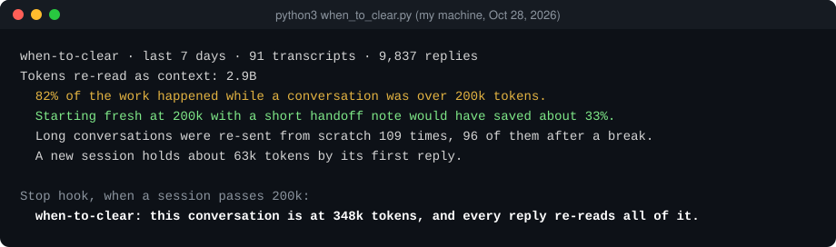

# when-to-clear

**看清 Claude Code 的用量有多少花在重读长对话上。到该 /clear 的时候,它会提醒你。**

[English](README.md) · MIT · Python 3.9+,不用装任何依赖 · 只读本机文件



AI 每回一句话,都要把整段对话重新发一遍。有缓存,这部分只收一折,可对话到了 40 万 token,你哪怕只说一句「好,继续」,模型动笔之前也要先把这 40 万重读一遍。

2026 年 10 月 28 日,我拿自己的记录跑了一下。最近 7 天,91 份对话记录(含子任务),9,837 次回复:

- **82% 的用量发生在对话超过 20 万 token 之后。**(这里的「用量」按 API 价格加权,算法见文末。)
- 如果每到 20 万就带一张交接便条换新会话,大约能省三分之一(33%),写便条、重新读文件的成本已经算进去了。
- 长对话没命中缓存、整段重新发送,一共 109 次,其中 96 次发生在我离开 5 分钟以上之后。
- 一个新会话,到第一次回复时就已经占了约 6.3 万 token:系统提示、工具、MCP 服务、CLAUDE.md、记忆,加上你的第一句话。

按 30 天算,90% 的用量发生在 20 万之后,到 20 万就重开能省 42%。

## 三样东西

**1. 报告。** 克隆仓库(或者只下载 `when_to_clear.py`),然后运行:

```sh
python3 when_to_clear.py
```

可选参数:`--days 30` 看更长时间;`--at 150k` 试试换一个重开的大小;`--dir` 指定别的记录目录;`--json` 输出原始数字。

**2. 提醒。** 一个 Stop 钩子(AI 每轮停下时自动运行)。对话超过 20 万 token 时,你会看到:

```text
when-to-clear: this conversation is at 348k tokens, and every reply re-reads all of it.
At your next stopping point, ask Claude to write a handoff note, then /clear and paste it.
```

默认设置下,之后每多 10 万(30 万、40 万……)再提醒一次,同一档只提醒一次,从不拦你。

**3. 交接技能。** 跟 AI 说「写个交接」,它会写好 `HANDOFF.md`:已完成(带证据)、正在做、未开始、下一步、卡在哪、代码分支、没提交的改动,再加几行代码里看不出来的背景。然后:

```text
/clear
Read HANDOFF.md and continue from Next step.
```

## 安装

**Claude Code 插件**(提醒 + 交接技能):

```text
/plugin marketplace add Balance0014/when-to-clear
/plugin install when-to-clear@when-to-clear
```

装完开一个新会话。报告不在插件里,要像上面那样从克隆的仓库里运行。

**不用插件:** 在 `~/.claude/settings.json` 里加上提醒,`--at` 改成你想要的大小:

```json
{
  "hooks": {
    "Stop": [{ "hooks": [{ "type": "command", "command": "python3 /path/to/when_to_clear.py hook --at 200k" }] }]
  }
}
```

**其他 agent:** `npx skills add Balance0014/when-to-clear` 安装交接技能。

## 数字怎么算的

报告读的是 Claude Code 每次回复时本来就记在 `~/.claude/projects` 里的 token 数。「用量」按 API 价格加权,以一个新输入 token 为 1:读缓存 0.1、写缓存 1.25(5 分钟缓存的价格)、输出 5。Anthropic 没有公开套餐额度怎么给这几类算权重,所以这些百分比请当作「工作量占比」看,不是套餐用量的精确值。

「能省多少」是拿你自己的历史重放出来的:对话一超过你设的大小,就当作在那里重开,新会话从这个会话自己的起步大小再加 3 万开始(约 5 千的便条,加约 2.5 万要重新读的文件),并算上写便条的成本。它假设会话后面的内容不变。如果你的 AI 重开后要重读的东西多得多,实际能省的会更少,可以改脚本里的 `HANDOFF` 来估。

数据不发往任何地方。暂不支持 Codex 的记录。

## 为什么做这个

我一个人开公司,同时开着大约 18 个 Claude Code 会话,还有 20 个定时 AI 任务([具体怎么管](https://github.com/Balance0014/one-person-ai-company);这个工具来自其中的[第 3 章](https://github.com/Balance0014/one-person-ai-company/blob/main/playbook/zh-CN/03-handoff-records.md)和[第 6 章](https://github.com/Balance0014/one-person-ai-company/blob/main/playbook/zh-CN/06-quota-budget.md)),全都用同一个套餐。一周的额度提前用完,定时任务也跟着停,要等重置才能恢复。上周就因为这个,少了四天的报告。那一周的额度花在哪了,我就是用这份报告查出来的。

---

作者 [Balance Zhao](https://github.com/Balance0014)。[在 X 上关注](https://x.com/balance0014),下一个工具发布时第一时间知道。
